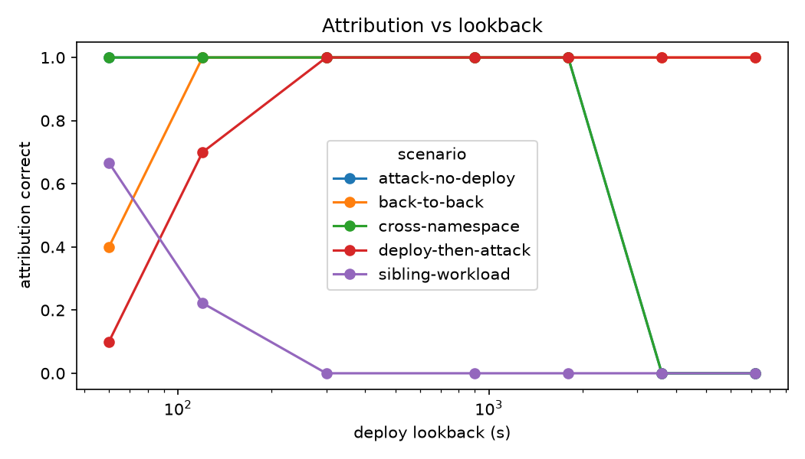
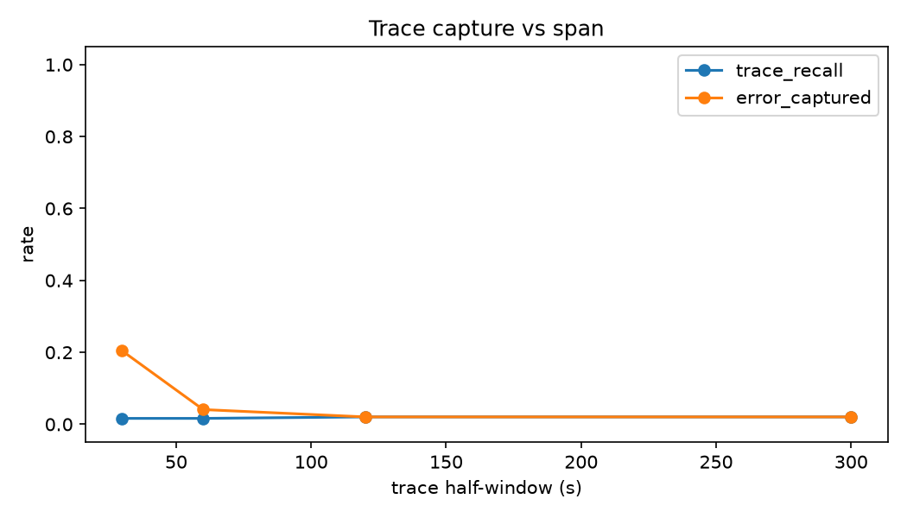

# 20261106T031609Z-correlate

## Live trials

| scenario           |   correct-none |   hit |   spurious |   undelivered |
|:-------------------|---------------:|------:|-----------:|--------------:|
| attack-no-deploy   |             10 |     0 |          0 |             0 |
| back-to-back       |              0 |    10 |          0 |             0 |
| cross-namespace    |             10 |     0 |          0 |             0 |
| deploy-then-attack |              0 |    10 |          0 |             0 |
| sibling-workload   |              0 |     0 |          9 |             1 |

- Trials: 50, delivered: 49 (98.0%)
- Attribution correct: 81.6%
- Falco detection (attack to alert time), s, median / p95 / max: 0.51 / 2.94 / 11.62
- Delivery (attack to incident visible), s: 1.50 / 22.73 / 23.86
- Final incident (alert to last trace refresh), s: 0.77 / 166.83 / 171.56
- Planted-trace recall, mean: 0.020
- Planted error trace captured: 2.0%

## Window ablation (replayed)

Attribution correct by lookback:

|   lookback_s |   attack-no-deploy |   back-to-back |   cross-namespace |   deploy-then-attack |   sibling-workload |
|-------------:|-------------------:|---------------:|------------------:|---------------------:|-------------------:|
|           60 |                  1 |            0.4 |                 1 |                  0.1 |              0.667 |
|          120 |                  1 |            1   |                 1 |                  0.7 |              0.222 |
|          300 |                  1 |            1   |                 1 |                  1   |              0     |
|          900 |                  1 |            1   |                 1 |                  1   |              0     |
|         1800 |                  1 |            1   |                 1 |                  1   |              0     |
|         3600 |                  0 |            1   |                 0 |                  1   |              0     |
|         7200 |                  0 |            1   |                 0 |                  1   |              0     |

Trace capture by span:

|   span_s |   trace_recall |   error_captured |
|---------:|---------------:|-----------------:|
|       30 |          0.016 |        0.204082  |
|       60 |          0.016 |        0.0408163 |
|      120 |          0.02  |        0.0204082 |
|      300 |          0.02  |        0.0204082 |

