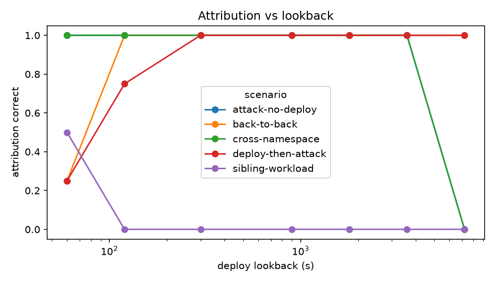
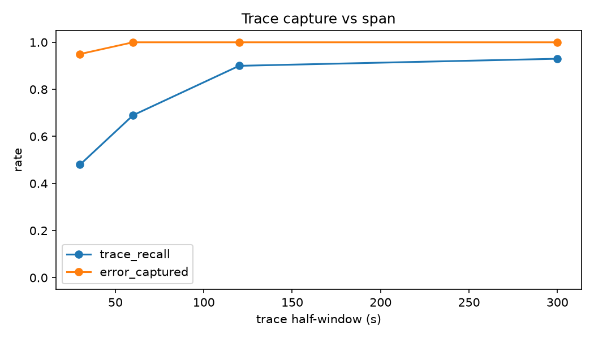

# 20261106T041022Z-correlate

## Live trials

| scenario           |   correct-none |   hit |   spurious |
|:-------------------|---------------:|------:|-----------:|
| attack-no-deploy   |              4 |     0 |          0 |
| back-to-back       |              0 |     4 |          0 |
| cross-namespace    |              4 |     0 |          0 |
| deploy-then-attack |              0 |     4 |          0 |
| sibling-workload   |              0 |     0 |          4 |

- Trials: 20, delivered: 20 (100.0%)
- Attribution correct: 80.0%
- Falco detection (attack to alert time), s, median / p95 / max: 0.19 / 0.61 / 0.65
- Delivery (attack to incident visible), s: 0.81 / 1.24 / 1.32
- Final incident (alert to last trace refresh), s: 165.97 / 167.06 / 167.30
- Planted-trace recall, mean: 0.880
- Planted error trace captured: 100.0%

## Window ablation (replayed)

Attribution correct by lookback:

|   lookback_s |   attack-no-deploy |   back-to-back |   cross-namespace |   deploy-then-attack |   sibling-workload |
|-------------:|-------------------:|---------------:|------------------:|---------------------:|-------------------:|
|           60 |                  1 |           0.25 |                 1 |                 0.25 |                0.5 |
|          120 |                  1 |           1    |                 1 |                 0.75 |                0   |
|          300 |                  1 |           1    |                 1 |                 1    |                0   |
|          900 |                  1 |           1    |                 1 |                 1    |                0   |
|         1800 |                  1 |           1    |                 1 |                 1    |                0   |
|         3600 |                  1 |           1    |                 1 |                 1    |                0   |
|         7200 |                  0 |           1    |                 0 |                 1    |                0   |

Trace capture by span:

|   span_s |   trace_recall |   error_captured |
|---------:|---------------:|-----------------:|
|       30 |           0.48 |             0.95 |
|       60 |           0.69 |             1    |
|      120 |           0.9  |             1    |
|      300 |           0.93 |             1    |

