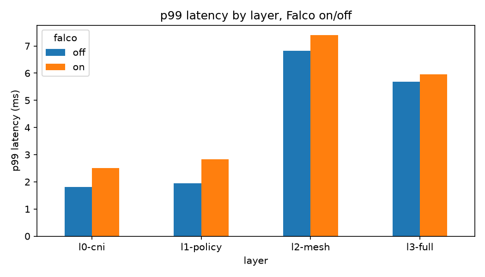

# 20261106T102037Z-overhead

## Request latency (k6, ms)

|                      |   ('p50_ms', 'mean') |   ('p50_ms', 'std') |   ('p95_ms', 'mean') |   ('p95_ms', 'std') |   ('p99_ms', 'mean') |   ('p99_ms', 'std') |   ('failed_rate', 'mean') |   ('failed_rate', 'std') |
|:---------------------|---------------------:|--------------------:|---------------------:|--------------------:|---------------------:|--------------------:|--------------------------:|-------------------------:|
| ('l0-cni', 'off')    |                0.448 |               0.023 |                0.894 |               0.065 |                1.817 |               0.355 |                         0 |                        0 |
| ('l0-cni', 'on')     |                0.475 |               0.086 |                1.081 |               0.166 |                2.511 |               0.47  |                         0 |                        0 |
| ('l1-policy', 'off') |                0.469 |               0.108 |                0.898 |               0.207 |                1.951 |               0.67  |                         0 |                        0 |
| ('l1-policy', 'on')  |                0.545 |               0.124 |                1.3   |               0.423 |                2.823 |               0.999 |                         0 |                        0 |
| ('l2-mesh', 'off')   |                2.001 |               0.015 |                3.615 |               0.498 |                6.821 |               1.684 |                         0 |                        0 |
| ('l2-mesh', 'on')    |                1.811 |               0.006 |                3.712 |               0.044 |                7.397 |               0.021 |                         0 |                        0 |
| ('l3-full', 'off')   |                2.011 |               0.094 |                3.341 |               0.008 |                5.691 |               0.078 |                         0 |                        0 |
| ('l3-full', 'on')    |                1.849 |               0.126 |                3.568 |               0.529 |                5.953 |               1     |                         0 |                        0 |

## Workload namespace cost (mean over reps)

|                                   |   cpu_cores |   mem_mib |
|:----------------------------------|------------:|----------:|
| ('l0-cni', 'off', 'app')          |      0.0296 |   64.2695 |
| ('l0-cni', 'on', 'app')           |      0.0276 |   58.3574 |
| ('l1-policy', 'off', 'app')       |      0.0295 |   57.2598 |
| ('l1-policy', 'on', 'app')        |      0.0341 |   62.0762 |
| ('l2-mesh', 'off', 'app')         |      0.0278 |   55.5528 |
| ('l2-mesh', 'off', 'istio-proxy') |      0.0552 |   70.8496 |
| ('l2-mesh', 'on', 'app')          |      0.029  |   55.8614 |
| ('l2-mesh', 'on', 'istio-proxy')  |      0.0479 |   71.0938 |
| ('l3-full', 'off', 'app')         |      0.041  |   78.3262 |
| ('l3-full', 'off', 'istio-proxy') |      0.053  |   71.293  |
| ('l3-full', 'on', 'app')          |      0.0384 |   82.0019 |
| ('l3-full', 'on', 'istio-proxy')  |      0.0466 |   72.3204 |

## Platform component cost during load (mean over cells)

|                              |   cpu_cores |   mem_mib |
|:-----------------------------|------------:|----------:|
| ('argocd', 'off')            |      0.0192 |  435.298  |
| ('argocd', 'on')             |      0.0213 |  438.728  |
| ('correlator', 'off')        |      0.0008 |   28.1853 |
| ('correlator', 'on')         |      0.0008 |   28.3464 |
| ('falco', 'off')             |      0.0036 |   88.8784 |
| ('falco', 'on')              |      0.0479 |  253.284  |
| ('gatekeeper-system', 'off') |      0.0303 |  190.08   |
| ('gatekeeper-system', 'on')  |      0.0323 |  188.565  |
| ('istio-ingress', 'off')     |      0.0032 |   53.7358 |
| ('istio-ingress', 'on')      |      0.004  |   57.7139 |
| ('istio-system', 'off')      |      0.0066 |  171.226  |
| ('istio-system', 'on')       |      0.0088 |  141.418  |
| ('kube-system', 'off')       |      0.1652 | 2182.58   |
| ('kube-system', 'on')        |      0.1854 | 2156.58   |
| ('mail', 'off')              |      0.0001 |   11.6455 |
| ('mail', 'on')               |      0.0001 |    9.9756 |
| ('observability', 'off')     |      0.118  | 1500.31   |
| ('observability', 'on')      |      0.1449 | 1504.89   |

